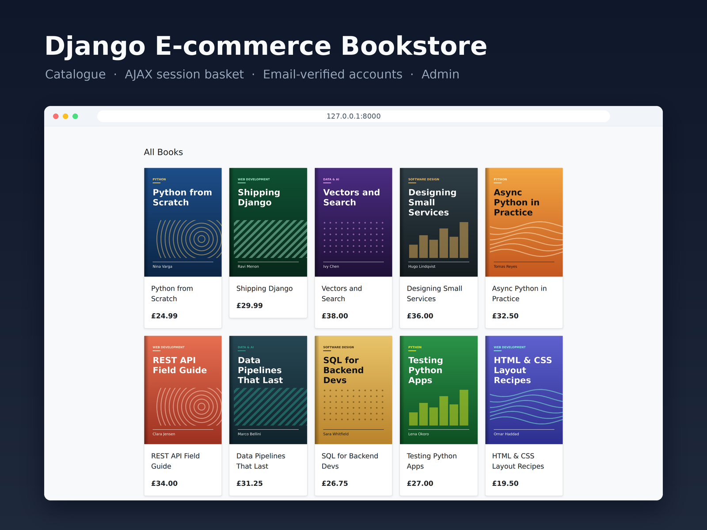
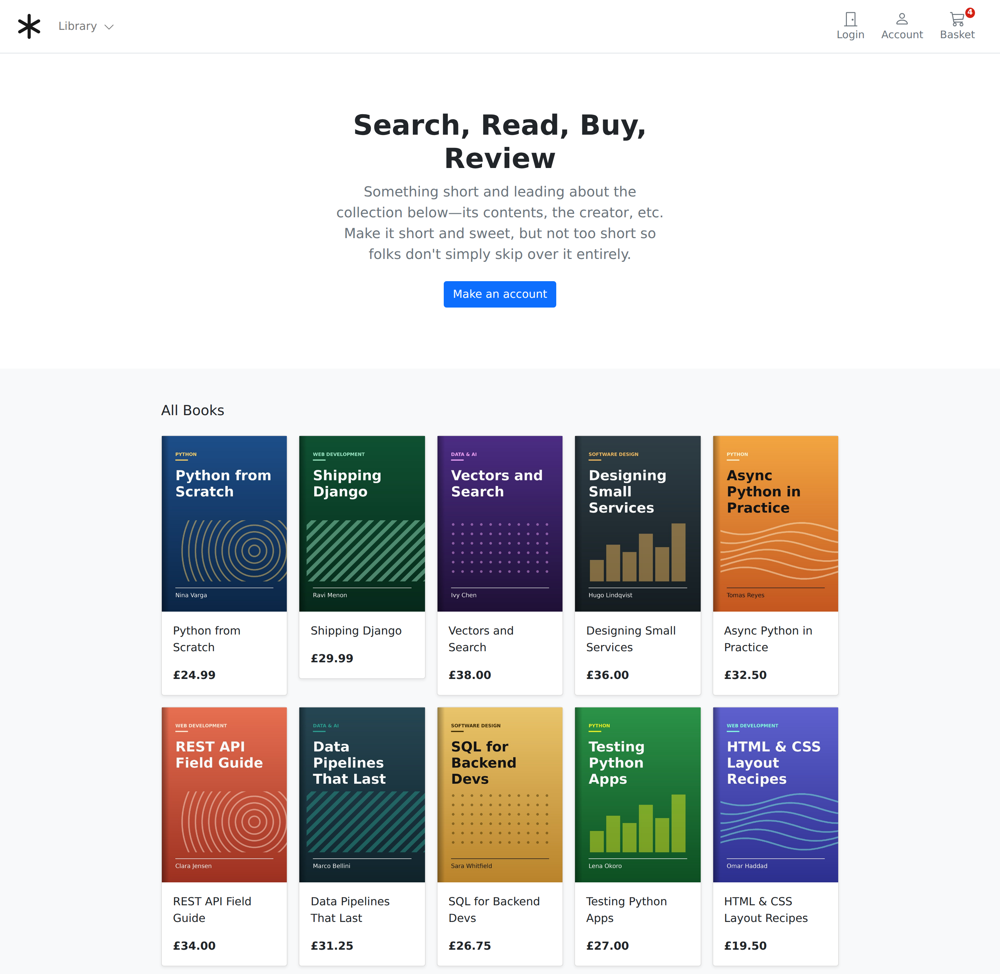
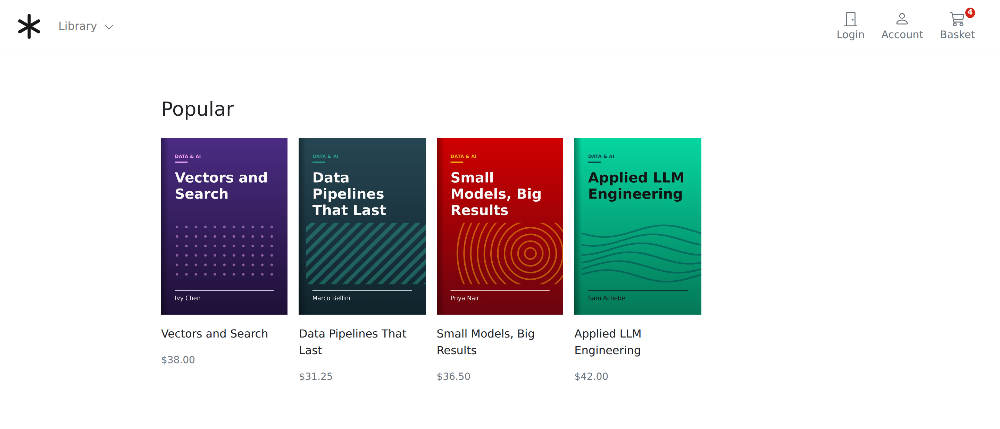
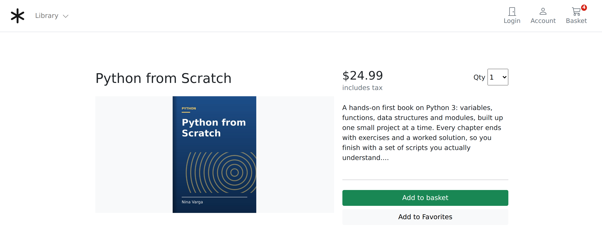
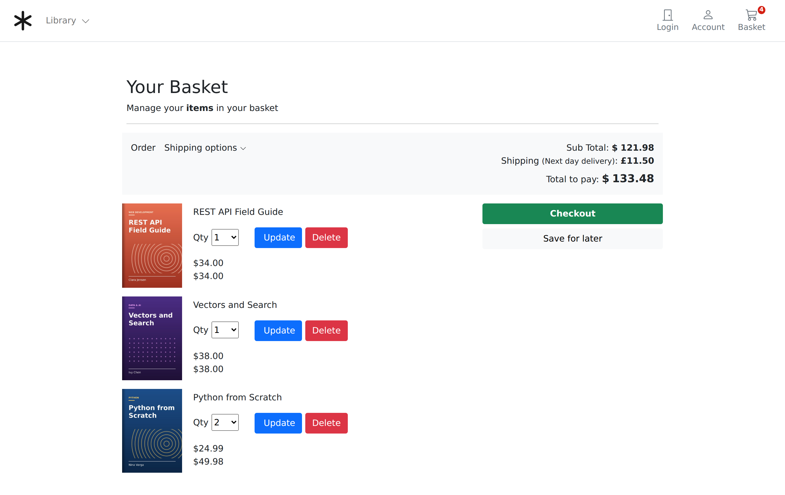
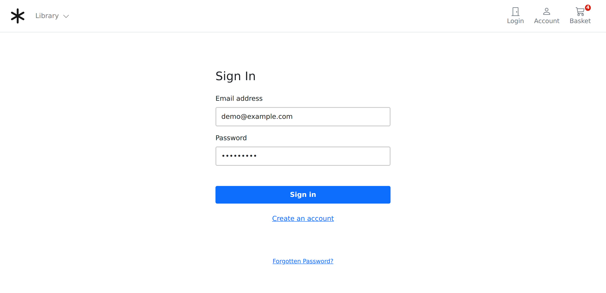
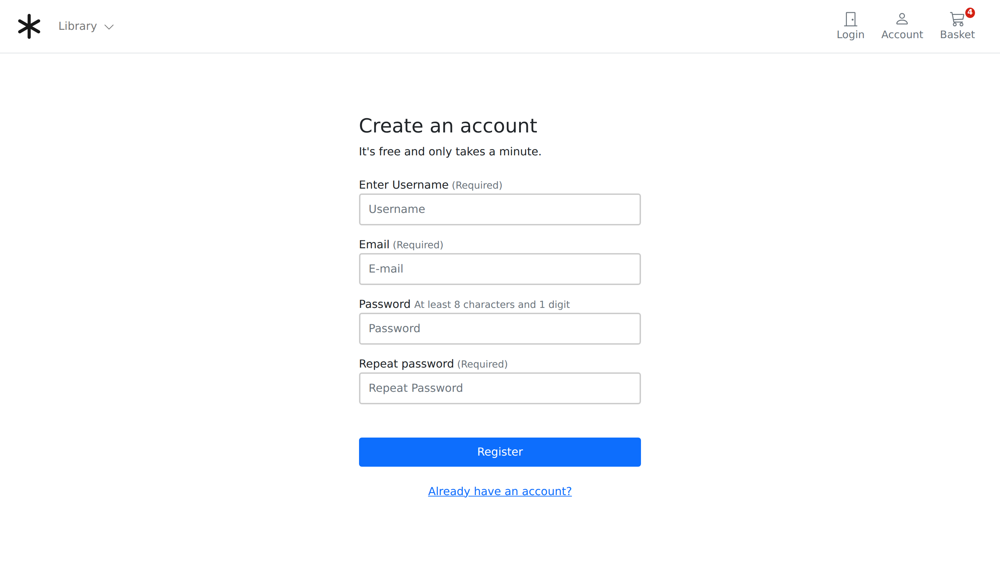
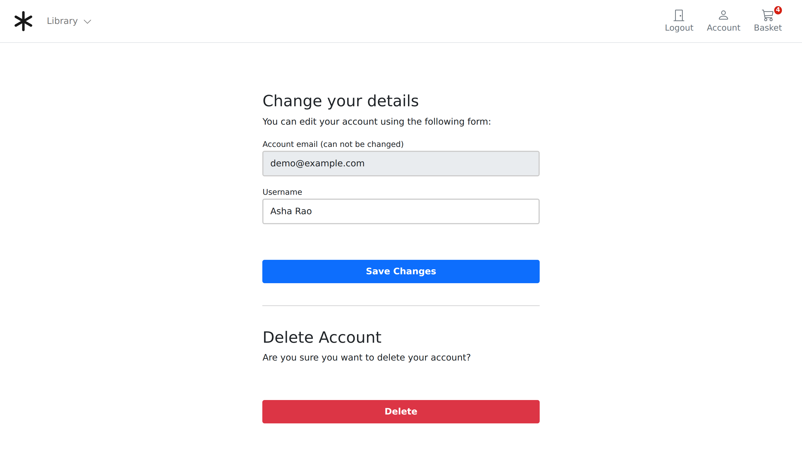
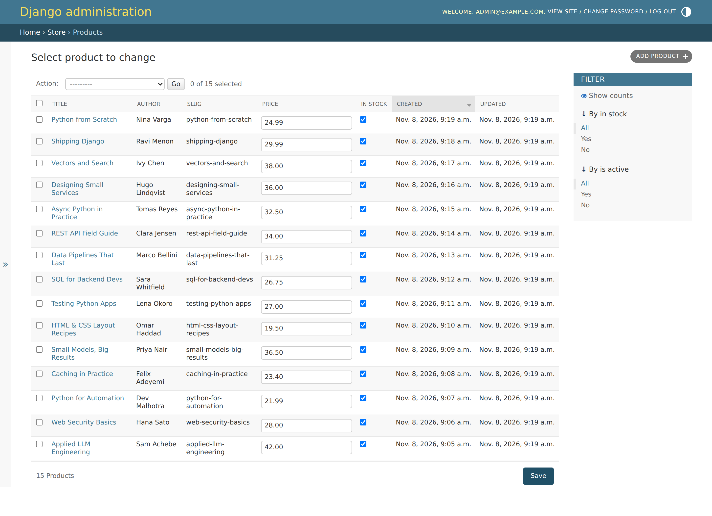

# Django E-commerce Bookstore

An online bookstore built with Django 5.2: a book catalogue with categories, a session-based basket that updates over AJAX, email-verified customer accounts, and the Django admin for managing stock and prices.



## Features

**Catalogue**
- `Category` and `Product` models with slugs, prices, stock and active flags, and cover images (`store/models.py`).
- A custom model manager, `Product.products`, keeps inactive products off the home page and out of the basket (`store/models.py`).
- Pages for all books, books in one category, and a single book by its slug (`store/views.py`, `store/urls.py`).
- The category menu is on every page, filled by a context processor (`store/context_processors.py`).

**Basket**
- A `Basket` class stored in the session, so visitors can shop without an account. It adds items, changes quantities, removes items, and works out line totals, the subtotal, a flat £11.50 delivery charge and the total (`basket/basket.py`).
- Add, update and delete are JSON endpoints called with jQuery AJAX, so the basket badge, line totals and totals change without a page reload (`basket/views.py`, `templates/store/products/single.html`, `templates/basket/summary.html`).
- The navbar shows the item count on every page, through a context processor (`basket/context_processors.py`).

**Accounts**
- A custom user model, `UserBase`, that signs in with an email address and has delivery-address fields, with the country chosen through django-countries. It has its own manager (`account/models.py`).
- Registration with email activation: a new account stays inactive until its owner opens the signed link that was emailed to them (`account/views.py`, `account/token.py`, `account/forms.py`).
- Sign in and sign out through Django's auth views, with Bootstrap-styled forms (`account/urls.py`, `account/forms.py`).
- Password reset by email (`account/urls.py`, `account/forms.py`).
- A dashboard and an edit-details page. Deleting an account deactivates the user rather than removing the row (`account/views.py`).
- In development, emails print to the console (`core/settings.py`).

**Admin**
- The product list in the admin lets staff edit price and stock inline, filter by stock and active status, and get slugs filled in from titles. Categories and accounts are in the admin too (`store/admin.py`, `account/admin.py`).

**Demo data**
- `python manage.py seed_demo` creates categories, books with generated cover images, an admin and a customer account (`store/management/commands/seed_demo.py`).

Not built yet: checkout, orders and payments (the Checkout button is a placeholder). The AJAX endpoints are plain Django views that return JSON. The project does not use Django REST Framework.

## Tech stack

- Python 3.10+ (tested on 3.14) and Django 5.2 LTS
- SQLite
- Django templates, Bootstrap 5 and jQuery (AJAX)
- Pillow (image fields and the generated demo covers) and django-countries

## Screenshots

| | |
|---|---|
| <br>**Home**: every active book | <br>**Category**: books in one category |
| <br>**Book detail**: quantity and Add to basket (AJAX) | <br>**Basket**: update or delete lines in place, with totals |
| <br>**Sign in** with email and password | <br>**Register**: activation link sent by email |
| <br>**Account**: edit details or delete the account | <br>**Admin**: inline price and stock editing |

## Run locally

You need Python 3.10 or newer.

```bash
git clone https://github.com/lollinng/Django_Eccomerce_project.git
cd Django_Eccomerce_project
python -m venv .venv
source .venv/bin/activate        # Windows: .venv\Scripts\activate
pip install -r requirements.txt
python manage.py migrate
python manage.py seed_demo       # demo categories, books and accounts
python manage.py runserver
```

Then open http://127.0.0.1:8000/.

| Account | Email | Password | Where |
|---|---|---|---|
| Customer | `demo@example.com` | `demo12345` | http://127.0.0.1:8000/account/login/ |
| Admin | `admin@example.com` | `demo12345` | http://127.0.0.1:8000/admin/ |

Use `python manage.py seed_demo --password <new password>` to set a different password for both accounts. Activation and password-reset emails print in the terminal that runs `runserver`. Open the link from there to finish signing up.

The settings are for local development only: `DEBUG` is on and the secret key is a development key. `seed_demo` will not run with `DEBUG` off.

## Project layout

```
core/      settings and root URLs
store/     categories, products, catalogue views, seed_demo command
basket/    session basket and its JSON endpoints
account/   custom user model, registration, activation, password reset
templates/ Django templates (Bootstrap 5)
static/    CSS
```

## Video

[](https://www.youtube.com/watch?v=Fe9ZR5nI-0c&t=26s)

## Disclaimer

This is a portfolio project that shows Django backend work. It is not meant for production use as it stands.
